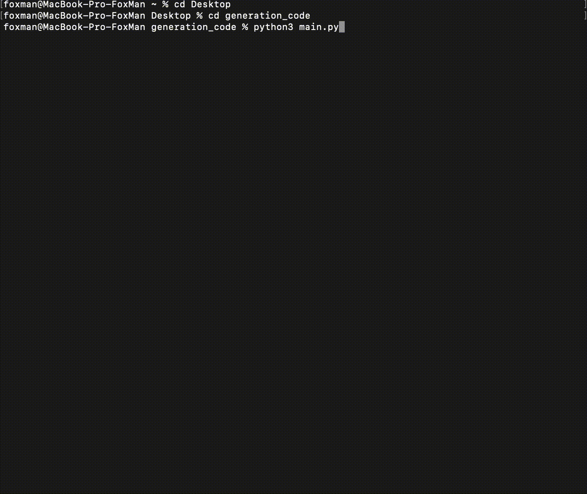

# Проект "Генератор паролей"

## Описание проекта
Данный проект создан для генерации паролей

## Цели проекта
- Создать код, который будет помогать создавать защищённые пароли неограниченной длины
- Помочь людям, получить индивидуальные пароли

## Используемые технологии
Python для создания генерации паролей

## Установка зависимостей
Загрузите необходимые файлы (скачайте репозиторий)

## Пример запуска
Для запуска у вас должен быть установлен Python3. Для генерации необходимо: перейти в папку с main.py. Затем записать:

```python
python3 main.py
```


Проект выполнен в образовательных целях на онлайн-курсе "Введение в програмирование на Python" онлайн-школы "Лидер".